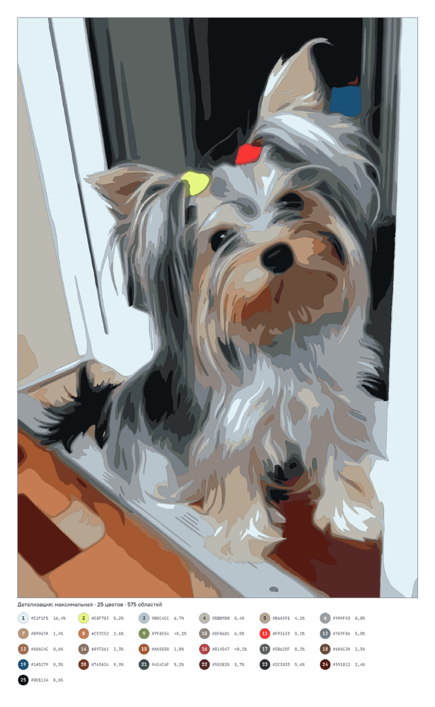

# Картина по номерам

Онлайн: [alexkaminsky.me/raznoe/kartina-po-nomeram](https://alexkaminsky.me/raznoe/kartina-po-nomeram/) · сайт автора: [alexkaminsky.me](https://alexkaminsky.me)

Подготовка картины к письму красками. Фото раскладывается на зоны под формат листа, палитра подбирается из своих красок, к каждому цвету даётся рецепт смешивания. Не раскраска на печать, а путь от фото до первого мазка.

Одна страница [`kartina-po-nomeram.html`](kartina-po-nomeram.html): скачать и открыть в браузере. Всё считается на месте, фото никуда не уходит, интернет не нужен.

## Пример

| Фото | Результат: вид «Раскраска» |
|---|---|
|  |  |

Детализация максимальная: 25 цветов, 575 областей, под картинкой — номера цветов, HEX и доля площади. Файл, как его сохраняет страница: [`yorkshire-raskraska.pdf`](examples/yorkshire-raskraska.pdf).

## Что умеет

- Контуры и номера зон, палитра с долями площади; детализация, сглаживание, различие тонов, редкие цвета.
- Зоны детализации и упрощения: обвести лицо — там зоны мельче, фон — крупнее; кисть упрощения убирает мелкие зоны вручную.
- Мазки по направлению, насыщенность цвета, защита мелких ярких пятен.
- Свои краски списком «название и HEX» или готовые наборы; рецепты смешивания по объёму и на 10 г.
- Лист A4 / A3 с полями и кадрированием, отдельный лист «Легенда» с рецептами; сохранение PNG, SVG, PDF и CSV.
- Встроенная инструкция — кнопка «Инструкция» на странице.

## Выкладывается как есть

Делалось для себя, не ради выгоды. Свой код — под лицензией MIT: кто хочет — пользуется и улучшает, гарантий нет.

**Внутри страницы два чужих компонента со своими лицензиями:**

- **Mixbox 2.0** (Secret Weapons) — модель смешивания красок, по которой считаются рецепты. Лицензия CC BY-NC 4.0: **только некоммерческое использование.** Для коммерческого — нужна лицензия у правообладателя: [scrtwpns.com/mixbox](https://scrtwpns.com/mixbox/).
- **jsPDF 2.5.1** — запись PDF, лицензия MIT.

Полный текст — в [LICENSE](LICENSE).

## Авторы

- **Алексей** ([allexx51-dev](https://github.com/allexx51-dev), [alexkaminsky.me](https://alexkaminsky.me)) — руководитель проекта: идея, требования, проверка.
- **Claude** (Anthropic) — программирование.
